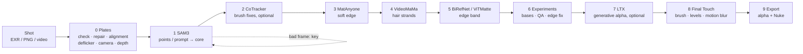

<div align="center">


# MatteDesk

**An interactive tool for cutting objects out of shots – alpha, matte, roto – right in the browser.**

Repair the plates once. Generate alpha mattes for multiple objects – the tool computes each mask for the whole shot. You fix only the frames that need it.

`SAM3.1` · `CoTracker3` · `MatAnyone2` · `VideoMaMa` · `BiRefNet / ViTMatte` · `Sapiens2` · `LTX 2.5 Alpha Gen` · `ComfyUI` · `Nuke / After Effects` · `Agent API + CLI` · `100% local, no cloud, no LLM required`

[](https://github.com/fishfinger44/MatteDesk/releases/download/v0.50/MatteDesk-0.50-setup.exe)

Windows 10 / 11 · NVIDIA GPU (CUDA): **12 GB VRAM minimum, 24 GB recommended** (stage 7 LTX-2.5 needs 24 GB + 64 GB RAM) · the button downloads the installer – all versions: [Releases](https://github.com/fishfinger44/MatteDesk/releases/latest) – the green **Code → Download ZIP** button gives the source code only (see [INSTALL_WINDOWS.txt](INSTALL_WINDOWS.txt))

**English** · [Polski](README.pl.md) · UI language: English by default, 🌐 switch to Polish in the header

Version: file [`VERSION`](VERSION) (also shown in the top-left corner of the UI) · history: [CHANGELOG.md](CHANGELOG.md)

</div>

[](https://youtu.be/GX3guDhhblk)

https://github.com/user-attachments/assets/9ed23b6d-7dcc-4421-b809-ef9bc2cbde86

https://github.com/user-attachments/assets/0bfc7a20-2bf8-45e8-8b95-1f910b0657e8

**New in 0.50 (55 s):** objects → a group made of them → the seam closing the gaps between members → Final Touch sliders and the MergeMatte comp (exported to Nuke as a node).

---

## 📖 Contents

1. [What it is for](#-what-it-is-for)
2. [How the work goes](#-how-the-work-goes)
3. [Features](#-features)
4. [Project status](#-project-status)
5. [Requirements](#-requirements)
6. [Installation](#-installation)
7. [Roadmap](#-roadmap)
8. [Repository layout](#-repository-layout)
9. [Author and licence](#-author-and-licence)

---

## 🎯 What it is for

Cutting an object out of a shot for compositing usually means manual roto, tracking and fixing frame by frame.
MatteDesk turns that into a short, controlled flow:

| | Step | What happens |
|:-:|---|---|
| 🩹 | **Repair the plates** | The tool checks the input frames and repairs broken ones – **once** – and the repaired plate is used everywhere downstream |
| 💬 | **Say what to cut out** | Type a phrase (SAM 3.1 understands English) or mark the object: click `+`/`−`, box, brush |
| 🔍 | **Automatic cropping** | The object gets a tight square crop, and the mask is computed for the whole shot |
| 👁 | **Frame-by-frame review** | Timeline with QA flags, A/B compare, wipe, diff, contours, comp preview over different backgrounds |
| ✋ | **Fix only the bad frames** | Your correction becomes a hard *key* – the mask is recomputed from it forwards and backwards |
| 📦 | **Export** | Alpha only (EXR / PNG), data for Nuke (`.nk`, multichannel EXR) and the `outputs.json` data contract |

The tool is **generic**: any project, any resolution, EXR / PNG / TIFF / DPX sequences or MP4 / MOV video.
There are no shot-specific paths or parameters in the code – everything comes from the shot manifest and `defaults.json`.

---

## 🧭 How the work goes



Every object goes through the stage bar **0 Plates · 1 SAM 3.1 · 2 CoTracker3 · 3 MatAnyone2 · 4 VideoMaMa · 5 ViTMatte / BiRefNet · 6 Experiments ·
7 LTX-2.5 · 8 Final Touch · 9 Export**. Stages 2, 4–8 are optional; Export is available as soon as the SAM 3.1 core exists, and you choose its source
(core, MatAnyone2, VideoMaMa, ViTMatte / BiRefNet, LTX-2.5, Final Touch or any version). Each stage panel says what it does and what it is best for. The stage bar
shows what is ready and what needs recomputing after your correction; undo is always available, and every change creates a new version
you can compare with the previous one (A / B / difference).

---

## ✨ Features

### 🩹 Plate check and repair
Rule: **repair a plate once and use the repaired version everywhere**. Before you cut anything, the tool scans the whole sequence
and flags suspicious frames:

| Problem | How it is detected |
|---|---|
| Missing / unreadable frame, NaN / Inf, wrong size | file analysis of every frame |
| **Exposure jump** | frame brightness vs. its neighbours (t±1, t±2); a normal lighting trend is not an alarm |
| **Image jump** (damaged or shifted frame) | interpolation error against the neighbours + phase-correlation shift; real camera motion does not raise a false alarm |
| **Duplicate** frame | comparison with the previous frame |

For every flagged frame you pick a repair method (the tool suggests the best one):

| Method | When |
|---|---|
| `mean` | missing / damaged frame with little motion – average of the neighbours |
| `flow` | strong motion – motion-compensated interpolation (DIS optical flow) |
| `gain` | exposure jump – channels matched to the neighbours |
| `keep` | leave unchanged (a deliberate decision) |

Repaired frames go to a separate sequence `<plate>_fix/` in the source encoding (EXR stays EXR with the same header);
the other frames are hard links, so no gigabytes are copied. **Nothing is written without your confirmation.**
The `_fix` sequence is a complete, repaired RGB plate – read it directly in Nuke / After Effects (MatteDesk's own export writes alpha only).

### 🧰 Plate preparation (stage 0)
- **Alignment** of the backlit and clear plate to the beauty (local CoTracker3 matching → displacement grid `align/grid_<plate>/`, < 1 MB/frame; STMap from the grid in Nuke, `.nk` export),
- **Deflicker and denoise** – flicker removed in linear space, without flattening intended lighting changes; one button measures the
  plate and sets the parameters, a 1024 px preview and a content check (no ghosting) before the full run, 4K without running out of RAM,
- **2D camera motion** with `Camera2D` export to Nuke,
- **Depth map** (DepthCrafter) with a stability check, suggesting the object order.

### ✂️ Cutting out
- **SAM3.1** finds the object from points or a text prompt in keyframes and propagates the core through the shot; crops follow the object automatically,
- **CoTracker3 brush fixes** – add / remove strokes in a few frames, carried to the rest of the shot by tracked points,
- **one edge band for every edge stage** (3 MatAnyone2, 4 VideoMaMa, 5 BiRefNet / ViTMatte, 7 LTX-2.5): sliders scale the band, band
  points tracked with CoTracker3 shape it (wide on hair, 0 = no band, e.g. on skin), inner / outer feathers, preview as dashed lines.
  The band belongs to the object – set it once, every stage uses it ("detach → own band" when one stage needs something else),
- **"Propose band (Sapiens2)"** (optional) – Sapiens2-seg-0.4B recognises body parts and sets the band points for people:
  wide on hair, narrow on clothes, thin on skin,
- **MatAnyone2** computes the soft, temporally stable edge in a band around the core,
- **VideoMaMa** adds hair strands and fine edge detail (live sliders for reach and edge protection, no model rerun),
- **stage 5 edge engine** for hair, fur, smoke and fibres in the band: **BiRefNet_HR-matting / Lucida** (MIT weights, also for
  commercial work) or **ViTMatte** (optional, non-commercial weights),
- **Experiments** – any computed version as a base, QA and edge-fix proposals on it, recompute from that base,
- **LTX-2.5 Alpha-Gen** (optional) – generative alpha for semi-transparent and thin things,
- **Final Touch** – manual alpha fixes on any version before export: brush (add / remove / erase, frame by frame), black / white /
  gamma, erode, blur and motion blur measured from the plate motion,
- **"👁 Preview frames"** in the model stages – a few frames around the current one before the long run on the whole shot,
- **multiple objects** computed front to back, and **object parts** (e.g. a dress as part of a character) with their own mask and seamless export,
- **loupe** for thin elements, alpha motion blur, temporal smoothing; mask overlays, outlines, Alpha view and comp drawn on the GPU.

### 🔬 Quality control
The mask is judged **as a whole, on every frame** – never on the crop alone. Temporal flicker map, flags on the timeline, edge accuracy
measured against the image gradient. After two failed automatic attempts the tool shows the result and offers a manual path.

### 🩺 Environment Doctor
The **Doctor** button checks ComfyUI, nodes, models, ffmpeg and the GPU. When something is missing it opens by itself at start-up and
gives each item an **Install** button with a progress bar (MB, speed, time left), plus a batch **"Install all missing"**.
It also switches between **ComfyUI Desktop** and **ComfyUI from git** (folder, models folder and port editable for both; empty = detected
automatically), warns when a **different** ComfyUI answers on the port (two installs on one machine), and shows the licence of every
third-party component. **Installed models** (LTX-2.5, VideoMaMa, MatAnyone2, ViTMatte, Sapiens2, MiniMax-Remover, LaMa) get a 🗑 button that
deletes **only their weights** after showing every file and its size – the stage that needs the model is then locked. SAM 3.1,
CoTracker3 and BiRefNet_HR-matting / Lucida (the stage-5 edge engine that stays without ViTMatte) have no bin. Nothing installs by
itself – only on a click.

### 🐞 Report a problem
The **🐞 Report a problem** button (in the header, in the "About" window and in every error window) sends the author a short
description with diagnostics: MatteDesk version, Windows, Python, GPU, ComfyUI version and VRAM, Doctor items that are not OK, the
last jobs and their errors, the tail of the log and – only if you tick it – a screenshot of the window. Paths, shot and object
names, your user name and computer name are replaced with placeholders (`<path>`, `<shot>`, `<obj>`, `<user>`), and **before
sending you see the whole package** and have to tick a consent box. The e-mail field is optional. Nothing is sent without
clicking "Send"; the report goes through a small relay to the author's private issue tracker (the app never holds a GitHub token).

### 🤖 API for AI agents and scripts
Everything the UI does is available over a local REST API and a command line, `tools/md.py` (standard library only) – documented
in [docs/AGENT_API.md](docs/AGENT_API.md). An AI coding agent (e.g. Claude Code) or a pipeline script can open a shot, start stages
and the overnight queue, read progress, QA and versions, and export – while "by eye" decisions (which object, where to put a key,
whether an edge is good) stay with the artist in the UI. Exports and other writes need an explicit confirmation flag.

### 🔒 Rules the tool enforces
- RGB always comes from the original plate – ComfyUI delivers **alpha only**,
- the shot manifest is read-only; the tool's state goes to `<shot>/matte_desk/`,
- one heavy computation at a time, with a "Stop" button.

---

## ✅ Project status

| Area | Status |
|---|---|
| 🩺 **Doctor + installer** (since v0.1) | ✅ works: finds what is missing, **installs** nodes and models with a progress bar, opens by itself at start-up |
| 📦 **Windows installer** (since v0.31) | ✅ one setup file: bundled Python, Start-menu / desktop shortcut opening an app window, uninstall; asks whether you have ComfyUI, otherwise downloads ComfyUI portable; update check at start |
| 🔀 **ComfyUI Desktop 2 / portable / from git** | ✅ auto-detection of folders, models and port; switch in the Doctor; shared-models option |
| 🏷 **Versioning** | ✅ `VERSION`, tag in the UI, `start_v<version>.bat`, `CHANGELOG.md`, `tools/bump_version.py` |
| 🌐 **UI language** | ✅ English (default) / Polish, switch in the header |
| 🩹 Plate check and repair | ✅ in the code and in the UI (stage 0) |
| 🧰 Alignment, deflicker, 2D camera | ✅ in the code; tests on real shots in progress |
| ✂️ Stages 1–3: SAM3.1 core, CoTracker3 brush fixes, MatAnyone2 edge; keys, multiple objects, parts, QA, export | ✅ works |
| 💇 Stage 4 VideoMaMa (hair strands) · stage 5 BiRefNet / ViTMatte · stage 6 Experiments · shared edge band, Sapiens2 band proposal | ✅ works; tested on real shots, being refined |
| 🧪 Stage 7 LTX-2.5 Alpha-Gen (optional, generative) | ✅ works; needs 24 GB VRAM |
| 🖌 Stage 8 Final Touch (manual alpha fixes before export) | ✅ works (since v0.35) |
| 🐞 Report a problem (anonymised, with consent) | ✅ works (since v0.35) |
| 🌿 "Local matting" zone | 🚧 in progress |

### What the Doctor installs (one click)

| Component | Source | Size | Required |
|---|---|---|:-:|
| **ffmpeg** (MP4 / MOV video, previews) | winget `Gyan.FFmpeg`; without winget – portable package from gyan.dev to `bin/ffmpeg` | ~100 MB | ✅ |
| **Git** (the Doctor clones nodes from GitHub and installs CoTracker3 with it) | winget `Git.Git` | ~60 MB | ✅ |
| Nodes `ComfyUI-PlateMatte`, `ComfyUI-MatAnyone2-Keyframes` | `handoff/comfy/custom_nodes/` (copied, old version to `backups/`) | – | ✅ |
| Node `ComfyUI-MatAnyone2` | GitHub `spiritform/comfy-matanyone2` + its requirements and `install.py` (packages `matanyone2`, `hydra-core`, `thinplate` in ComfyUI's Python – the Doctor checks them) | a few MB | ✅ |
| **SAM3.1** weights (`sam3.1_multiplex_fp16`) | Hugging Face `Comfy-Org/sam3.1` | 1.7 GB | ✅ |
| **MatAnyone2** weights | GitHub `pq-yang/MatAnyone2` | 135 MB | ✅ |
| **CoTracker3** (package for ComfyUI's Python + weights) | pip `--no-deps` + Hugging Face `facebook/cotracker3` | 100 MB | recommended |
| **ViTMatte** weights ("hair" zones / `vitmatte` engine; runs in ComfyUI's Python) | Hugging Face `hustvl/vitmatte-base-composition-1k` (+ `transformers`, only if missing) | 390 MB | ❌ optional (weights **non-commercial only** – Adobe-trained) |
| **BiRefNet_HR-matting / Lucida** weights (stage 5 edge engine, MIT – also for commercial work; ComfyUI's Python) | Hugging Face `ZhengPeng7/BiRefNet_HR-matting`, `egeorcun/lucida` (+ `timm`, only if missing) | 444 + 885 MB | ✅ for stage 5 |
| **Sapiens2-seg-0.4B** weights (optional „Propose band” – body parts → band points, people only; Sapiens2 License, commercial use allowed; ComfyUI's Python with transformers ≥ 5) | Hugging Face `facebook/sapiens2-seg-0.4b` | 1.63 GB | ❌ optional |
| **Plate alignment on the GPU** (`engine/align_gpu_worker.py` in ComfyUI's Python; check only – uses ComfyUI's torch and CUDA) | – | 0 | no (speed-up; CPU otherwise) |
| **VideoHelperSuite** nodes (`VHS_LoadImagesPath` – 8-bit PNG/JPG shots in SAM 3.1, MatAnyone2, zones) | GitHub `Kosinkadink/ComfyUI-VideoHelperSuite` + its requirements (`imageio-ffmpeg` ~30 MB) | ~1 MB | ✅ for 8-bit shots |
| **DepthCrafter** nodes ("Depth" feature) | GitHub `akatz-ai` (the 4–6 GB model downloads on first use) | < 1 MB | optional |
| **MiniMax-Remover** nodes + weights (future Inpainting module) | GitHub `1038lab` + Hugging Face `zibojia/minimax-remover` | 2.6 GB | no (not used yet) |
| `comfyui-inpaint-nodes` nodes + **LaMa** weights | GitHub `Acly` + `big-lama.pt` | 196 MB | optional |
| **ComfyUI-VideoMaMa** node + weights (stage 4 "VideoMaMa": VideoMaMa UNet, SVD-xt fp16 image encoder + VAE → `models/videomama/`) | `git clone` github.com/okdalto/ComfyUI-VideoMaMa into custom_nodes (+ `requirements.txt`) and Hugging Face `SammyLim/VideoMaMa` + parts of `stabilityai/stable-video-diffusion-img2vid-xt`; ComfyUI restart after the node install; not part of "Install all" | ~7.1 GB | optional (~8 GB VRAM at a 448 px crop, ~16 GB at 1280 px) |
| **LTX-2.5 Alpha-Gen** models (stage 7 "LTX-2.5": int8 transformer, int8 Gemma, video + audio VAE, IC-LoRA Alpha-Gen; the nodes are in ComfyUI core ≥ 0.39) | Hugging Face `Lightricks/LTX-2.5` + `Lightricks/LTX-2.5-22b-IC-LoRA-Alpha-Gen` – "gated" repos: first `hf auth login` and "Agree and Access" (LTX-2.x licence); downloads resume after an interruption; not part of "Install all" | ~40 GB | optional (24 GB VRAM + ≥ 64 GB RAM) |

It does not install ComfyUI itself (when it is missing, the Doctor shows a "ComfyUI (installation)" item linking to ComfyUI Desktop: https://www.comfy.org/download) or Python (MatteDesk runs on it – `start_v….bat` installs it). MatteDesk **has no PyTorch of its own** – everything computed on the GPU (SAM3.1, MatAnyone2, DepthCrafter, CoTracker3) runs in ComfyUI's Python (ViTMatte too – as a persistent process `engine/vitmatte_worker.py`; plate alignment – `engine/align_gpu_worker.py`,
`align_device` = auto | gpu | cpu in `config.local.json`, the CPU version stays as a fallback; the same worker computes "Alpha motion blur" –
`mb_device` = auto | gpu | cpu); that keeps the tool folder at about 0.8 GB.

**ComfyUI autostart:** when MatteDesk starts and ComfyUI is not running, the tool starts the one chosen in the Doctor (ComfyUI Desktop or ComfyUI from git); this can be switched off in the Doctor ("start ComfyUI together with MatteDesk").
- **Comfy Desktop 2:** the app itself only opens a launcher and waits for an install to be clicked (there is no flag or deep link that starts the server), so MatteDesk starts the install's server **without the app window** – the same way Desktop does: `.venv\Scripts\python.exe -s main.py` from the install folder (`ComfyUI-Installs\<name>\ComfyUI`), the model yaml from `%APPDATA%\Comfy Desktop\instance-model-paths`, shared `input` / `output` from Desktop's settings, the install's `launchArgs` + `--listen <comfy_host> --port <comfy_port>`. The server runs in its own console window (log; closing the window stops ComfyUI). Install: `comfy_dir` if it points to a Desktop 2 install, otherwise the one started last. If you then open Comfy Desktop and click the install, Desktop sees the port taken and picks another one – use one or the other.
- **Older ComfyUI Desktop** (no Desktop 2 install): the app (`comfy_desktop_exe`) is started and it starts the server itself.
- `comfy_cpu_affinity` (optional, `config.local.json`, hex mask, e.g. `"FFFFF0FF"`): ComfyUI started by MatteDesk in its own console (Desktop 2 / from git) gets only these logical cores (Windows).

---

## 💻 Requirements

| | |
|---|---|
| System | Windows 10 / 11 |
| GPU | NVIDIA (tested on an RTX 4090 24 GB; with 12 GB MatAnyone2 needs a VRAM patch – the Doctor will tell you) |
| Software | **ComfyUI** (Desktop, portable or from git) – the installer can download ComfyUI portable for you; **Python** comes with the installer (from source: `start_v….bat` installs Python 3.11); **ffmpeg** and **Git** are installed by the Doctor |
| Disk space | about 3 GB for models + plenty for shot data (≥ 50 GB free recommended) |

You only install **ComfyUI** by hand (Desktop – recommended – or from git). **Python 3.11** is installed by `start_v<version>.bat` on the first start
(winget, current user only) when it is not found; **ffmpeg** and **Git** are installed by the Doctor ("Install" button).
The Doctor needs Git for the nodes from GitHub – a zip download is enough to get MatteDesk itself.

---

## 🚀 Installation

### Windows installer (recommended)

1. Download **`MatteDesk-<version>-setup.exe`** from [Releases](https://github.com/fishfinger44/MatteDesk/releases) and run it.
   It installs for your user only (no admin rights) into `%LOCALAPPDATA%\Programs\MatteDesk`, with its own Python and all
   dependencies (nothing goes into your system Python, no internet needed for this part).
2. **"Where should MatteDesk get ComfyUI from?"**
   - **Download ComfyUI portable** (default) → the installer downloads the official **ComfyUI portable** (NVIDIA, ~2 GB download,
     ~6.5 GB on disk) into a folder you choose – resumable, SHA-256 checked. It can be extended later as usual (ComfyUI-Manager, models).
   - **I already have ComfyUI** → MatteDesk finds it by itself – ComfyUI Desktop, the portable package or ComfyUI from git (a running
     one with its port and Python). Your models stay where they are. Only if it is not found, point to its folder (optional field).
   - **Later** → set it up in the Doctor (choose this when updating an install that already has ComfyUI set up).
3. Start **MatteDesk** from the Start menu or the desktop: it opens in its own window (Edge app mode, no address bar) and starts
   the server in the background. Closing the window stops MatteDesk (it asks first when something is being computed).
4. The **Doctor** opens by itself and installs our nodes and the models into your ComfyUI (step 4 below); then restart ComfyUI.

**Updates:** at start MatteDesk checks (at most once a day) whether a newer version is in Releases and shows a short list of
changes with a link to the full changelog: **Update** downloads the new setup and runs it (settings stay), **Later**, or
"do not remind me about this version". Can be switched off in the Doctor.
**Uninstall:** Windows Settings → Apps → MatteDesk. Removes the program and its settings; your shots and ComfyUI (also a portable
one downloaded by the installer) stay.

<details>
<summary><b>Building the installer yourself</b></summary>

Needs Inno Setup 6 (`winget install JRSoftware.InnoSetup`) and git. `python tools/build_installer.py` → `dist/MatteDesk-<version>-setup.exe`:
public copy of the committed code, Python 3.11 (python-build-standalone, with tkinter) + `requirements.txt`, `7zr.exe`; downloads are
SHA-256 checked. The installer script is `installer/MatteDesk.iss`.
</details>

### From source (git)

**1. ComfyUI Desktop.** Install it ([docs.comfy.org](https://docs.comfy.org/installation/desktop/overview)) and run it once.
The tool finds its folders and port (usually 8188) by itself, and later starts ComfyUI together with MatteDesk.

**2. Get MatteDesk.**

```bash
git clone https://github.com/fishfinger44/MatteDesk.git
cd MatteDesk
```

**3. Run `start_v<version>.bat`** (e.g. `start_v0.3.bat`). On the first start it creates the `.venv` environment, installs the dependencies
and opens http://127.0.0.1:8765. Closing the console window stops the server.

**4. Fill the gaps in the Doctor.** It opens by itself when something is missing. Click **"Install all missing (required)"**:

- copies our nodes (`ComfyUI-PlateMatte`, `ComfyUI-MatAnyone2-Keyframes`) to `custom_nodes`,
- clones the `ComfyUI-MatAnyone2` node and installs its requirements,
- downloads the **SAM3.1** (1.7 GB), **MatAnyone2** (135 MB), **CoTracker3** (100 MB) and **BiRefNet_HR-matting / Lucida** (1.3 GB) weights;
  optional models (VideoMaMa, LTX-2.5, ViTMatte, Sapiens2, LaMa) have their own Install buttons.

Check the licence shown next to each component – some models are for non-commercial use only (see [THIRD_PARTY_LICENSES.md](THIRD_PARTY_LICENSES.md)).

**5. Restart ComfyUI** – with the "🔁 Restart ComfyUI" button in the Doctor – and click "Refresh test". When everything is green, you are done.

**6. Open a shot.** The **📁 Project** button → a shot manifest, or a video file / sequence folder (the wizard creates a project).

<details>
<summary><b>ComfyUI portable or from git instead of Desktop</b></summary>

In the Doctor choose **"ComfyUI from git / portable"** at the top and give the folder with `main.py` and the port (portable package:
`ComfyUI_windows_portable\ComfyUI`; MatteDesk recognises `python_embeded` next to it, installs node requirements with that Python
and starts ComfyUI the same way as `run_nvidia_gpu.bat`). The **"models shared with Desktop"** option
downloads weights into one folder – ComfyUI from git then has to point to it in its `extra_model_paths.yaml`.
The "Install" buttons act on the active ComfyUI. The paths of both variants are stored separately in `config.local.json`
(a file for this computer only, outside git; template: `config.local.example.json`).
</details>

<details>
<summary><b>Updating and tests</b></summary>

```bash
git pull origin main
.venv\Scripts\python.exe -m pytest -q -m "not real"   # synthetic tests (long)
.venv\Scripts\python.exe -m pytest -m real            # only on a station with shot data, ComfyUI and a GPU
```
After UI changes refresh the browser (Ctrl+F5).
</details>

---

## 🔭 Roadmap

**In progress**
- 🌿 **"Local matting" zone** – adding hair, fur, fibres, smoke and motion blur in a marked area, also over a non-uniform background.
  The engine is picked automatically (chroma / KNN / MatAnyone2 / backlit), zone keys sit on the timeline, obstacles (e.g. hands, animals) are excluded,
  and the result has a faithful preview and a correction loop.
- 🪟 **Nicer Doctor and install windows** – instead of the system `alert` / `confirm`: own windows with a summary of what will be done,
  the result of each step (✅ / ❌) and a readable error; installing several things as a list of steps with progress.
- 🔁 **Clear ComfyUI restart notice** – after installing nodes a large, persistent banner "Restart ComfyUI, otherwise the nodes will not work"
  (with a list of what waits for the restart), a "waiting for restart" tag on installed items and detection that Comfy has been restarted.
- ⚡ **Performance and quality** – faster SAM 3.1 frame preview, finishing the tests on real shots.

**Later**
- 🐧 **Linux and macOS versions** – start script, installer and Doctor without Windows assumptions.
- 🌐 **ComfyUI on another machine in the LAN** – MatteDesk on a laptop / Linux box, ComfyUI on any GPU machine in the network.
- 🪶 **"Lite" profile for 8 GB GPUs** – smaller models / crops chosen by the installer and the Doctor.
- 🎬 **After Effects export** (masks + comp).
- 🗺 **Specification roadmap** – depth (E1e), cropping and objects (E2–E3b), keys and propagation (E4), QA and edge accuracy (E5–E5b), export and data contract (E6).
- 🌍 **Generalisation (E7)** – shots without a backlit plate and 8-bit video with people (commercials), with no code changes.
- 🧙 **Finishing the installer** – the DepthCrafter and MiniMax-Remover nodes in "Install all" and a first-run wizard.

**Separate tools on a shared core** *(not built without a decision)*
- 🎥 **Camera3D + Mesh** – 3D camera solve and mesh in Blender, fed by MatteDesk mattes.
- 🧽 **Plate cleanup** (formerly "Inpainting" + tracked layer) – removing rigs, wires, holders using finished masks:
  clean plate → background from other frames → a patch pinned to a tracked surface (CoTracker3 → STMap) → an inpainting model;
  Bezier curve / bitmap in tracked space with correction keys; by default only the cleaned patch is exported (option: full composite).

---

## 🗂 Repository layout

| Path | Contents |
|---|---|
| `app.py`, `comfy_client.py`, `doctor.py` | server, ComfyUI client, Doctor |
| `engine/` | engine: plate check and repair, cropping, SAM 3.1, keys, QA, export, installer, configuration |
| `static/` | user interface (HTML / JS / CSS); `static/i18n/en.json` = English catalog |
| `handoff/` | ComfyUI nodes to install |
| `docs/` | agent / CLI API (`AGENT_API.md`), data contract (`DATA_CONTRACT.md`) |
| `tools/` | `md.py` (command-line control), `bump_version.py` (versioning), `i18n_extract.py` (strings missing from the English catalog) |
| `tests/` | tests (synthetic; `real` only on a station with shot data) |
| `config.json` / `config.local.json` | shared configuration / configuration of this computer (outside git) |

Versions: small change 0.11 → 0.12 (`python tools/bump_version.py "description"`), bigger one 0.40 → 0.50 (`--major`; always two digits, so GitHub lists 0.50 above 0.49).

**Translations:** Polish is the source language of the code; the browser translates the UI to English at run time from
`static/i18n/en.json`. After adding UI text run `python tools/i18n_extract.py` – it lists the strings missing from the catalog.

---

## 📜 Author and licence

**MatteDesk** © 2026 Lech Gruszewski.

The code is licensed under **GNU GPL-3.0-or-later** ([LICENSE](LICENSE)). You may use it (also for commercial work),
modify and redistribute it. Any redistributed modified version must be released under the same licence,
keeping the author notice.

**Third-party models and nodes are not part of MatteDesk.** The Doctor downloads them from their original sources to your computer,
and only when you click. Their own licences apply. **MatAnyone2, CoTracker3, VideoMaMa and DepthCrafter are for non-commercial /
research use only.** Full list: [THIRD_PARTY_LICENSES.md](THIRD_PARTY_LICENSES.md).

### ☕ Support

MatteDesk is free. If it saved you hours of roto, you can buy me a coffee on [Ko-fi](https://ko-fi.com/fishfinger)
(also the **Sponsor** button at the top of the repository). Support is voluntary and unlocks nothing – everyone gets the same program.

[](https://ko-fi.com/fishfinger)

Bugs and ideas: the **Issues** tab of the repository.
