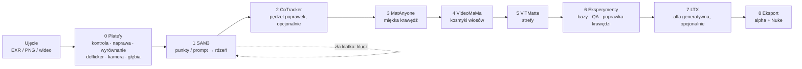

<div align="center">


# MatteDesk

**Interaktywne narzędzie do wycinania obiektów z ujęć – alpha, matte, roto – prosto z przeglądarki.**

Raz naprawiasz plate'y. Generujesz maski alfa wielu obiektów – narzędzie liczy każdą maskę na całe ujęcie. Ty poprawiasz tylko te klatki, które tego wymagają.

`SAM3.1` · `CoTracker3` · `MatAnyone2` · `VideoMaMa` · `ViTMatte` · `LTX 2.5 Alpha Gen` · `ComfyUI` · `Nuke / After Effects` · `API dla agentów + CLI` · `100% lokalnie, bez chmury, LLM niepotrzebny`

[](https://github.com/fishfinger44/MatteDesk/releases/download/v0.37/MatteDesk-0.37-setup.exe)

Windows 10 / 11 · karta NVIDIA · przycisk pobiera instalator – wszystkie wersje: [Releases](https://github.com/fishfinger44/MatteDesk/releases/latest) – zielony przycisk **Code → Download ZIP** daje tylko kod źródłowy (patrz [INSTALL_WINDOWS.txt](INSTALL_WINDOWS.txt))

[English](README.md) · **Polski** · język interfejsu: domyślnie angielski, 🌐 przełącznik na polski w nagłówku

Wersja: plik [`VERSION`](VERSION) (widoczna też w lewym górnym rogu UI) · historia: [CHANGELOG.md](CHANGELOG.md)

</div>

---

## 📖 Spis treści

1. [Do czego służy](#-do-czego-służy)
2. [Jak wygląda praca](#-jak-wygląda-praca)
3. [Co potrafi](#-co-potrafi)
4. [Stan projektu](#-stan-projektu)
5. [Wymagania](#-wymagania)
6. [Instalacja](#-instalacja)
7. [Plany na przyszłość](#-plany-na-przyszłość)
8. [Struktura repozytorium](#-struktura-repozytorium)

---

## 🎯 Do czego służy

Wycięcie obiektu z ujęcia do compositingu to zwykle ręczne roto, śledzenie i poprawianie klatka po klatce.
MatteDesk zamienia to w krótki, kontrolowany przepływ:

| | Krok | Co się dzieje |
|:-:|---|---|
| 🩹 | **Napraw plate'y** | Narzędzie sprawdza klatki wejściowe i naprawia uszkodzone – **raz**, a poprawiony plate jest używany wszędzie dalej |
| 💬 | **Powiedz, co wyciąć** | Wpisujesz frazę (SAM 3.1 rozumie ją po angielsku) albo zaznaczasz obiekt: klik `+`/`−`, prostokąt, pędzel |
| 🔍 | **Automatyczne kadrowanie** | Obiekt dostaje ciasny, kwadratowy wycinek, a maska jest liczona na całe ujęcie |
| 👁 | **Przegląd klatka po klatce** | Oś czasu z flagami QA, porównania A/B, wipe, diff, kontury, podgląd compu na różnych tłach |
| ✋ | **Popraw tylko złe klatki** | Twoje zaznaczenie staje się twardym *kluczem* – maska jest przeliczana od niego w przód i w tył |
| 📦 | **Eksport** | Sama alpha (EXR / PNG), dane dla Nuke (`.nk`, EXR wielokanałowy) i kontrakt danych `outputs.json` |

Narzędzie jest **uniwersalne**: dowolny projekt, dowolna rozdzielczość, sekwencje EXR / PNG / TIFF / DPX albo wideo MP4 / MOV.
W kodzie nie ma ścieżek ani parametrów konkretnego ujęcia – wszystko pochodzi z manifestu ujęcia i `defaults.json`.

---

## 🧭 Jak wygląda praca



Każdy obiekt przechodzi przez pasek etapów **0 Plate'y · 1 SAM 3.1 · 2 CoTracker3 · 3 MatAnyone2 · 4 VideoMaMa · 5 ViTMatte · 6 Eksperymenty ·
7 LTX-2.5 · 8 Eksport**. Etapy 2 i 4–7 są opcjonalne; Eksport jest dostępny od razu po rdzeniu SAM 3.1, a źródło wybierasz (rdzeń, MatAnyone2,
VideoMaMa, ViTMatte, LTX-2.5 albo dowolna wersja). Panel każdego etapu mówi, co robi i do czego jest najlepszy. Pasek pokazuje, co jest gotowe,
a co wymaga przeliczenia po Twojej poprawce; cofanie jest zawsze dostępne, a każda zmiana tworzy nową wersję do porównania (A / B / różnica).

---

## ✨ Co potrafi

### 🩹 Kontrola i naprawa plate'ów
Zasada: **plate naprawiasz raz, a poprawioną wersję używasz wszędzie**. Zanim cokolwiek wytniesz, narzędzie przegląda całą sekwencję
i oznacza podejrzane klatki:

| Problem | Jak jest wykrywany |
|---|---|
| Brakująca / nieczytelna klatka, NaN / Inf, zły rozmiar | analiza pliku każdej klatki |
| **Skok ekspozycji** | jasność klatki vs. jej sąsiedzi (t±1, t±2); zwykły trend światła nie jest alarmem |
| **Skok obrazu** (uszkodzona lub przesunięta klatka) | błąd interpolacji względem sąsiadów + przesunięcie z korelacji fazowej; prawdziwy ruch kamery nie daje fałszywego alarmu |
| **Duplikat** klatki | porównanie z poprzednią klatką |

Dla każdej oznaczonej klatki wybierasz metodę naprawy (narzędzie podpowiada najlepszą):

| Metoda | Kiedy |
|---|---|
| `mean` | brakująca / uszkodzona klatka przy małym ruchu – średnia sąsiadów |
| `flow` | duży ruch – interpolacja kompensowana ruchem (przepływ optyczny DIS) |
| `gain` | skok ekspozycji – wyrównanie kanałów do sąsiadów |
| `keep` | zostawiasz bez zmian (świadoma decyzja) |

Naprawione klatki trafiają do osobnej sekwencji `<plate>_fix/` w kodowaniu źródła (EXR zostaje EXR-em z tym samym nagłówkiem),
reszta klatek to dowiązania twarde, więc nie kopiuje się gigabajtów. **Nic nie jest zapisywane bez Twojego potwierdzenia.**
Sekwencja `_fix` to kompletny, naprawiony plate RGB – wczytujesz go wprost w Nuke'u / After Effects (sam eksport MatteDesk zapisuje tylko alfę).

### 🧰 Przygotowanie plate'ów (etap 0)
- **Wyrównanie** backlitu i clear plate'u do beauty (dopasowanie lokalne CoTracker3 → siatka przesunięć `align/grid_<plate>/`, < 1 MB/kl.; w Nuke'u STMap z siatki, eksport `.nk`),
- **Deflicker i odszumianie** – migotanie usuwane w przestrzeni liniowej, bez spłaszczania zamierzonych zmian światła,
- **Ruch kamery 2D** z eksportem `Camera2D` do Nuke,
- **Mapa głębi** (DepthCrafter) z kontrolą stabilności, podpowiadająca kolejność obiektów.

### ✂️ Wycinanie
- **SAM3.1** znajduje obiekt z punktów albo frazy w klatkach kluczowych i propaguje rdzeń na całe ujęcie; kadry jadą za obiektem automatycznie,
- **poprawki pędzlem z CoTracker3** – kreski dodaj / usuń w kilku klatkach, przenoszone na resztę ujęcia śledzonymi punktami,
- **MatAnyone2** liczy miękką, stabilną w czasie krawędź w pasie wokół rdzenia,
- **VideoMaMa** dokłada kosmyki włosów i detal krawędzi (suwaki zasięgu i ochrony krawędzi na żywo, bez ponownego liczenia modelu),
- **strefy ViTMatte** dla włosów, futra, dymu i włókien – malowany pas albo cały obrys minus wykluczenia, śledzone z obiektem,
- **Eksperymenty** – dowolna policzona wersja jako baza, QA i propozycje poprawki krawędzi, przeliczenie z tej bazy,
- **LTX-2.5 Alpha-Gen** (opcjonalnie) – generatywna alfa dla rzeczy półprzezroczystych i cienkich,
- **wiele obiektów** liczonych od przodu do tyłu oraz **części obiektu** (np. suknia jako część postaci) z własną maską i eksportem bez szwu,
- **lupa** na cienkich elementach, regulacja szerokości i położenia krawędzi, motion blur alfy, wygładzanie w czasie.

### 🔬 Kontrola jakości
Maska jest oceniana **w całości, na każdej klatce** – nigdy na samym wycinku. Mapa migotania w czasie, flagi na osi, pomiar dokładności
krawędzi względem gradientu obrazu. Po dwóch nieudanych próbach automatycznych narzędzie pokazuje wynik i proponuje ścieżkę ręczną.

### 🩺 Doktor środowiska
Przycisk **Doktor** sprawdza ComfyUI, węzły, modele, ffmpeg i GPU. Gdy czegoś brakuje, otwiera się sam przy starcie i przy każdej pozycji
daje przycisk **Zainstaluj** z paskiem postępu (MB, prędkość, czas do końca) oraz zbiorczy **„Zainstaluj wszystkie brakujące”**.
Jest też przełącznik między **ComfyUI Desktop** a **ComfyUI z gita**.

### 🐞 Zgłoś problem
Przycisk **🐞 Zgłoś problem** (w nagłówku, w oknie „O programie” i w każdym oknie błędu) wysyła autorowi krótki opis z diagnostyką:
wersja MatteDesk, Windows, Python, GPU, wersja ComfyUI i VRAM, pozycje Doktora inne niż OK, ostatnie zadania i ich błędy, końcówka
logu oraz – tylko gdy to zaznaczysz – zrzut okna. Ścieżki, nazwy ujęć i obiektów, nazwa użytkownika i komputera są zastępowane
znacznikami (`<path>`, `<shot>`, `<obj>`, `<user>`), a **przed wysłaniem widzisz całą paczkę** i musisz zaznaczyć zgodę. Pole e-mail
jest opcjonalne. Bez kliknięcia „Wyślij” nic nie wychodzi z komputera; zgłoszenie idzie przez mały pośrednik do prywatnej listy
zgłoszeń autora (aplikacja nie ma żadnego tokenu GitHub).

### 🤖 API dla agentów AI i skryptów
Wszystko, co robi interfejs, jest dostępne przez lokalne REST API i wiersz poleceń `tools/md.py` (sama biblioteka standardowa) –
opis w [docs/AGENT_API.md](docs/AGENT_API.md). Agent AI (np. Claude Code) albo skrypt pipeline'u może otworzyć ujęcie, uruchomić
etapy i kolejkę na noc, czytać postęp, QA i wersje oraz eksportować – a decyzje „na oko” (który obiekt, gdzie klucz, czy krawędź jest
dobra) zostają u artysty w interfejsie. Eksport i inne zapisy wymagają jawnej flagi potwierdzenia.

### 🔒 Zasady, które narzędzie wymusza
- RGB zawsze z oryginalnego plate'u – ComfyUI dostarcza **wyłącznie alphę**,
- manifest ujęcia jest tylko do odczytu, stan narzędzia trafia do `<ujęcie>/matte_desk/`,
- jedno ciężkie liczenie naraz, z przyciskiem „Przerwij”.

---

## ✅ Stan projektu

| Obszar | Status |
|---|---|
| 🩺 **Doktor + instalator** (od v0.1) | ✅ działa: wykrywa braki, **instaluje** węzły i modele z paskiem postępu, otwiera się sam przy starcie |
| 📦 **Instalator Windows** (od v0.31) | ✅ jeden plik setup: wbudowany Python, skrót w menu Start / na pulpicie otwierający okno aplikacji, deinstalacja; pyta, czy masz ComfyUI, inaczej pobiera ComfyUI portable; sprawdzanie aktualizacji przy starcie |
| 🔀 **ComfyUI Desktop 2 / portable / z gita** | ✅ autodetekcja folderów, modeli i portu; przełącznik w Doktorze; opcja wspólnych modeli |
| 🏷 **Wersjonowanie** | ✅ `VERSION`, znacznik w UI, `start_v<wersja>.bat`, `CHANGELOG.md`, `tools/bump_version.py` |
| 🩹 Kontrola i naprawa plate'ów | ✅ w kodzie i w UI (etap 0) |
| 🧰 Wyrównanie, deflicker, kamera 2D | ✅ w kodzie; testy na prawdziwych ujęciach w toku |
| ✂️ Etapy 1–3: rdzeń SAM3.1, poprawki pędzlem CoTracker3, krawędź MatAnyone2; klucze, wiele obiektów, części, QA, eksport | ✅ działa |
| 💇 Etap 4 VideoMaMa (kosmyki włosów, v0.3) · etap 5 strefy ViTMatte · etap 6 Eksperymenty | ✅ działa; testowane na prawdziwych ujęciach, dopracowywane |
| 🧪 Etap 7 LTX-2.5 Alpha-Gen (opcjonalny, generatywny) | ✅ działa; wymaga 24 GB VRAM |
| 🌐 **Język interfejsu** | ✅ angielski (domyślnie) / polski, przełącznik w nagłówku |
| 🌿 Strefa „matting lokalny” | 🚧 w budowie |

### Co instaluje Doktor (jednym kliknięciem)

| Składnik | Źródło | Rozmiar | Wymagany |
|---|---|---|:-:|
| **ffmpeg** (wideo MP4 / MOV, podglądy) | winget `Gyan.FFmpeg`; bez wingeta – paczka portable z gyan.dev do `bin/ffmpeg` | ~100 MB | ✅ |
| **Git** (Doktor klonuje nim węzły z GitHuba i instaluje CoTracker3) | winget `Git.Git` | ~60 MB | ✅ |
| Węzły `ComfyUI-PlateMatte`, `ComfyUI-MatAnyone2-Keyframes` | `handoff/comfy/custom_nodes/` (kopia, stara wersja do `backups/`) | – | ✅ |
| Węzeł `ComfyUI-MatAnyone2` | GitHub `spiritform/comfy-matanyone2` + jego wymagania i `install.py` (pakiet `matanyone2`, `hydra-core`, `thinplate` w Pythonie ComfyUI – Doktor sprawdza, czy są) | kilka MB | ✅ |
| Wagi **SAM3.1** (`sam3.1_multiplex_fp16`) | Hugging Face `Comfy-Org/sam3.1` | 1,7 GB | ✅ |
| Wagi **MatAnyone2** | GitHub `pq-yang/MatAnyone2` | 135 MB | ✅ |
| **CoTracker3** (pakiet do Pythona ComfyUI + wagi) | pip `--no-deps` + Hugging Face `facebook/cotracker3` | 100 MB | zalecane |
| Wagi **ViTMatte** (strefy „włosy” / silnik `vitmatte`; liczy się w Pythonie ComfyUI) | Hugging Face `hustvl/vitmatte-base-composition-1k` (+ `transformers`, tylko gdy brak) | 390 MB | ✅ dla stref włosów (wagi **tylko niekomercyjnie** – trenowane na zbiorze Adobe) |
| Wagi **BiRefNet_HR-matting / Lucida** (opcjonalne modele krawędzi strefy ViTMatte, MIT – do pracy komercyjnej; Python ComfyUI) | Hugging Face `ZhengPeng7/BiRefNet_HR-matting`, `egeorcun/lucida` (+ `timm`, tylko gdy brak) | 444 + 885 MB | ❌ opcjonalne |
| Wagi **Sapiens2-seg-0.4B** (opcjonalne „Zaproponuj pas” – części ciała → punkty pasa, tylko ludzie; Sapiens2 License, komercyjnie OK; Python ComfyUI z transformers ≥ 5) | Hugging Face `facebook/sapiens2-seg-0.4b` | 1,63 GB | ❌ opcjonalne |
| **Wyrównanie plate'ów na GPU** (`engine/align_gpu_worker.py` w Pythonie ComfyUI; tylko sprawdzenie – używa torcha i CUDA z ComfyUI) | – | 0 | nie (przyspieszenie; bez tego CPU) |
| Węzły **VideoHelperSuite** (`VHS_LoadImagesPath` – ujęcia 8-bit PNG/JPG w SAM 3.1, MatAnyone2, strefach) | GitHub `Kosinkadink/ComfyUI-VideoHelperSuite` + jego wymagania (`imageio-ffmpeg` ~30 MB) | ~1 MB | ✅ dla ujęć 8-bit |
| Węzły **DepthCrafter** (funkcja „Głębia”) | GitHub `akatz-ai` (model 4–6 GB pobiera się przy 1. użyciu) | < 1 MB | opcjonalnie |
| Węzły + wagi **MiniMax-Remover** (przyszły moduł Inpainting) | GitHub `1038lab` + Hugging Face `zibojia/minimax-remover` | 2,6 GB | nie (jeszcze nieużywane) |
| Węzły `comfyui-inpaint-nodes` + wagi **LaMa** | GitHub `Acly` + `big-lama.pt` | 196 MB | opcjonalnie |
| Węzeł **ComfyUI-VideoMaMa** + wagi (etap 4 „VideoMaMa”: UNet VideoMaMa, image encoder + VAE SVD-xt fp16 → `models/videomama/`) | `git clone` github.com/okdalto/ComfyUI-VideoMaMa do custom_nodes (+ `requirements.txt`) i Hugging Face `SammyLim/VideoMaMa` + części `stabilityai/stable-video-diffusion-img2vid-xt`; po instalacji węzła restart ComfyUI; nie wchodzi do „Zainstaluj wszystkie” | ~7,1 GB | opcjonalnie (~8 GB VRAM przy kadrze 448 px, ~16 GB przy 1280 px) |
| Modele **LTX-2.5 Alpha-Gen** (etap 7 „LTX-2.5”: transformer int8, Gemma int8, VAE wideo + audio, IC-LoRA Alpha-Gen; węzły są w rdzeniu ComfyUI ≥ 0.39) | Hugging Face `Lightricks/LTX-2.5` + `Lightricks/LTX-2.5-22b-IC-LoRA-Alpha-Gen` – repo „gated”: najpierw `hf auth login` i „Agree and Access” (licencja LTX-2.x); pobieranie wznawia się po przerwaniu; nie wchodzi do „Zainstaluj wszystkie” | ~40 GB | opcjonalnie (24 GB VRAM + ≥ 64 GB RAM) |

Nie instaluje: samego ComfyUI (gdy go brak, Doktor pokazuje pozycję „ComfyUI (instalacja)” z linkiem do ComfyUI Desktop: https://www.comfy.org/download) ani Pythona (MatteDesk na nim działa – instaluje go `start_v….bat`). MatteDesk **nie ma własnego PyTorcha** – wszystko, co liczy na GPU (SAM3.1, MatAnyone2, DepthCrafter, CoTracker3), działa w Pythonie ComfyUI (ViTMatte też – jako stały proces `engine/vitmatte_worker.py`; wyrównanie plate'ów – `engine/align_gpu_worker.py`,
`align_device` = auto | gpu | cpu w `config.local.json`, wersja CPU zostaje jako zapasowa; ten sam worker liczy „Motion blur alfy” –
`mb_device` = auto | gpu | cpu); dzięki temu folder narzędzia waży ok. 0,8 GB.

**Autostart ComfyUI:** przy starcie MatteDesk, gdy ComfyUI nie działa, narzędzie samo uruchamia ten wybrany w Doktorze (ComfyUI Desktop albo ComfyUI z gita); można to wyłączyć w Doktorze („uruchamiaj ComfyUI razem z MatteDesk”).
- **Comfy Desktop 2:** sama aplikacja otwiera tylko launcher i czeka na kliknięcie instalacji (nie ma flagi ani deep linku, który uruchamia serwer), więc MatteDesk startuje serwer instalacji **bez okna aplikacji** – tak jak robi to Desktop: `.venv\Scripts\python.exe -s main.py` z folderu instalacji (`ComfyUI-Installs\<nazwa>\ComfyUI`), yaml modeli z `%APPDATA%\Comfy Desktop\instance-model-paths`, wspólne `input` / `output` z ustawień Desktopu, `launchArgs` instalacji + `--listen <comfy_host> --port <comfy_port>`. Serwer działa we własnym oknie konsoli (log; zamknięcie okna zatrzymuje ComfyUI). Instalacja: `comfy_dir`, jeśli wskazuje instalację Desktop 2, inaczej ostatnio uruchamiana. Jeśli potem otworzysz Comfy Desktop i klikniesz instalację, Desktop zobaczy zajęty port i wybierze inny – używaj jednego albo drugiego.
- **Starsza ComfyUI Desktop** (bez instalacji Desktop 2): uruchamiana jest aplikacja (`comfy_desktop_exe`), ona sama startuje serwer.
- `comfy_cpu_affinity` (opcjonalnie, `config.local.json`, maska hex, np. `"FFFFF0FF"`): ComfyUI uruchamiany przez MatteDesk we własnej konsoli (Desktop 2 / z gita) dostaje tylko te rdzenie logiczne (Windows).

---

## 💻 Wymagania

| | |
|---|---|
| System | Windows 10 / 11 |
| GPU | NVIDIA (testowane na RTX 4090 24 GB; przy 12 GB MatAnyone2 wymaga łatki VRAM – Doktor o tym powie) |
| Oprogramowanie | **ComfyUI** (Desktop, portable albo z gita) – instalator może sam pobrać ComfyUI portable; **Python** jest w instalatorze (ze źródeł: `start_v….bat` instaluje Pythona 3.11); **ffmpeg** i **Git** instaluje Doktor |
| Miejsce | ok. 3 GB na modele + dużo na dane ujęć (zalecane ≥ 50 GB wolnego) |

Ręcznie instalujesz tylko **ComfyUI** (Desktop – zalecane – albo z gita). **Python 3.11** instaluje `start_v<wersja>.bat` przy pierwszym starcie
(winget, tylko dla bieżącego użytkownika), gdy go nie znajdzie; **ffmpeg** i **Git** instaluje Doktor (przycisk „Zainstaluj”).
Git jest potrzebny Doktorowi do węzłów z GitHuba – do pobrania samego MatteDesk wystarczy paczka.

---

## 🚀 Instalacja

### Instalator Windows (zalecane)

1. Pobierz **`MatteDesk-<wersja>-setup.exe`** z [Releases](https://github.com/fishfinger44/MatteDesk/releases) i uruchom.
   Instaluje się tylko dla Ciebie (bez uprawnień administratora) do `%LOCALAPPDATA%\Programs\MatteDesk`, z własnym Pythonem
   i wszystkimi zależnościami (nic nie trafia do systemowego Pythona, ta część nie potrzebuje internetu).
2. **„Skąd MatteDesk ma wziąć ComfyUI?”**
   - **Pobierz ComfyUI portable** (domyślnie) → instalator pobierze oficjalne **ComfyUI portable** (NVIDIA, ok. 2 GB do pobrania,
     ok. 6,5 GB na dysku) do wybranego folderu – ze wznawianiem i sprawdzeniem SHA-256. Rozbudowujesz go potem normalnie (ComfyUI-Manager, modele).
   - **Mam już ComfyUI** → MatteDesk sam go znajdzie – ComfyUI Desktop, paczkę portable albo ComfyUI z gita (działający – z jego
     portem i Pythonem). Modele zostają tam, gdzie są. Tylko gdy nie znajdzie, wskaż folder (pole opcjonalne).
   - **Później** → ustawisz to w Doktorze (wybierz przy aktualizacji instalacji, która ma już ustawione ComfyUI).
3. Uruchom **MatteDesk** z menu Start albo z pulpitu: otwiera się we własnym oknie (tryb aplikacji Edge, bez paska adresu),
   a serwer startuje w tle. Zamknięcie okna zatrzymuje MatteDesk (gdy coś się liczy – najpierw pyta).
4. **Doktor** otworzy się sam i zainstaluje nasze węzły i modele w Twoim ComfyUI (krok 4 niżej), potem restart ComfyUI.

**Aktualizacje:** przy starcie MatteDesk sprawdza (najwyżej raz dziennie), czy w Releases jest nowsza wersja, i pokazuje krótką
listę zmian z linkiem do pełnego changelogu: **Zaktualizuj** pobiera nowy setup i go uruchamia (ustawienia zostają), **Później**
albo „nie przypominaj o tej wersji”. Można wyłączyć w Doktorze.
**Deinstalacja:** Ustawienia Windows → Aplikacje → MatteDesk. Usuwa program i jego ustawienia; Twoje ujęcia i ComfyUI (także
portable pobrane przez instalator) zostają.

<details>
<summary><b>Budowanie instalatora samemu</b></summary>

Potrzebny Inno Setup 6 (`winget install JRSoftware.InnoSetup`) i git. `python tools/build_installer.py` → `dist/MatteDesk-<wersja>-setup.exe`:
publiczna kopia zacommitowanego kodu, Python 3.11 (python-build-standalone, z tkinterem) + `requirements.txt`, `7zr.exe`; pobrania
sprawdzane SHA-256. Skrypt instalatora: `installer/MatteDesk.iss`.
</details>

### Ze źródeł (git)

**1. ComfyUI Desktop.** Zainstaluj go ([docs.comfy.org](https://docs.comfy.org/installation/desktop/overview)) i uruchom raz.
Narzędzie samo znajdzie jego foldery i port (zwykle 8188), a później samo uruchomi ComfyUI przy starcie MatteDesk.

**2. Pobierz MatteDesk.**

```bash
git clone https://github.com/fishfinger44/MatteDesk.git
cd MatteDesk
```

**3. Uruchom `start_v<wersja>.bat`** (np. `start_v0.3.bat`). Przy pierwszym starcie tworzy środowisko `.venv`, instaluje zależności
i otwiera http://127.0.0.1:8765. Zamknięcie okna konsoli zatrzymuje serwer.

**4. Uzupełnij braki w Doktorze.** Otworzy się sam, gdy czegoś brakuje. Kliknij **„Zainstaluj wszystkie brakujące (wymagane)”**:

- kopiuje nasze węzły (`ComfyUI-PlateMatte`, `ComfyUI-MatAnyone2-Keyframes`) do `custom_nodes`,
- klonuje węzeł `ComfyUI-MatAnyone2` i instaluje jego wymagania,
- pobiera wagi **SAM3.1** (1,7 GB) i **MatAnyone2** (135 MB); opcjonalnie LaMa (196 MB) i CoTracker3 (100 MB).

**5. Zrestartuj ComfyUI** – przyciskiem „🔁 Zrestartuj ComfyUI” w Doktorze – i kliknij „Odśwież test”. Gdy wszystko jest zielone – gotowe.

**6. Otwórz ujęcie.** Przycisk **📁 Projekt** → manifest ujęcia albo plik wideo / folder sekwencji (kreator utworzy projekt).

<details>
<summary><b>ComfyUI portable albo z gita zamiast Desktopa</b></summary>

W Doktorze wybierz u góry **„ComfyUI z gita / portable”**, podaj folder z `main.py` i port (paczka portable:
`ComfyUI_windows_portable\ComfyUI`; MatteDesk rozpoznaje `python_embeded` obok, instaluje wymagania węzłów tym Pythonem
i uruchamia ComfyUI tak jak `run_nvidia_gpu.bat`). Opcja **„modele wspólne z Desktopem”** każe
pobierać wagi do jednego folderu – wtedy ComfyUI z gita musi wskazywać go w swoim `extra_model_paths.yaml`.
Przyciski „Zainstaluj” działają na aktywnym ComfyUI. Ścieżki obu wariantów są zapisane osobno w `config.local.json`
(plik tylko dla tego komputera, poza gitem; wzór: `config.local.example.json`).
</details>

<details>
<summary><b>Aktualizacja i testy</b></summary>

```bash
git pull origin main
.venv\Scripts\python.exe -m pytest -q -m "not real"   # testy syntetyczne (długie)
.venv\Scripts\python.exe -m pytest -m real            # tylko na stacji z danymi, ComfyUI i GPU
```
Po zmianach w interfejsie odśwież przeglądarkę (Ctrl+F5).
</details>

---

## 🔭 Plany na przyszłość

**W toku**
- 🌿 **Strefa „matting lokalny”** – dokładanie włosów, futra, włókien, dymu i rozmycia ruchu w zaznaczonym obszarze, także na niejednolitym tle.
  Automat dobiera silnik (chroma / KNN / MatAnyone2 / backlit), klucze strefy leżą na osi czasu, przeszkody (np. ręce, zwierzęta) są wyłączane,
  a wynik ma wierny podgląd i pętlę korekty.
- 🪟 **Ładniejsze okna w Doktorze i przy instalacji** – zamiast systemowych `alert` / `confirm`: własne okna z podsumowaniem tego, co zostanie zrobione,
  wynikiem każdego kroku (✅ / ❌) i czytelnym błędem; instalacja wielu rzeczy jako lista kroków z postępem.
- 🔁 **Wyraźna informacja o restarcie ComfyUI** – po instalacji węzłów duży, stały baner „Zrestartuj ComfyUI, inaczej węzły nie zadziałają”
  (z listą tego, co czeka na restart), znacznik „czeka na restart” przy zainstalowanych pozycjach i wykrycie, kiedy Comfy został już zrestartowany.
- 🧪 **Pierwszy prawdziwy przebieg na tym komputerze** – instalacja przez Doktora, restart ComfyUI i test na ujęciu.
- ⚡ **Wydajność i jakość** – szybszy podgląd klatki SAM 3.1, pełna rozdzielczość nakładek, domknięcie testów na prawdziwych ujęciach.

**Dalej**
- 🐧 **Wersje na Linuxa i macOS** – skrypt startowy, instalator i Doktor bez założeń Windowsa.
- 🌐 **ComfyUI na innej maszynie w LAN-ie** – MatteDesk na laptopie / Linuxie, ComfyUI na dowolnej maszynie z GPU w sieci.
- 🪶 **Profil „lite” dla kart 8 GB** – mniejsze modele / kadry dobierane przez instalator i Doktora.
- 🎬 **Eksport do After Effects** (maski + comp).
- 🗺 **Mapa drogowa specyfikacji** – głębia (E1e), kadrowanie i obiekty (E2–E3b), klucze i propagacja (E4), QA i dokładność krawędzi (E5–E5b), eksport i kontrakt danych (E6).
- 🌍 **Generalizacja (E7)** – ujęcia bez backlitu i wideo 8-bit z człowiekiem (reklamy), bez zmian w kodzie.
- 🧙 **Dokończenie instalatora** – węzły DepthCrafter i MiniMax-Remover w „Zainstaluj wszystkie” i kreator pierwszego uruchomienia.
- 💬 **Polecenia tekstowe po polsku** (opcjonalnie) – „dodaj / usuń X”, tłumaczone na frazę dla SAM3.

**Osobne narzędzia na wspólnym rdzeniu** *(nie budowane bez decyzji)*
- 🎥 **Camera3D + Mesh** – solve kamery 3D i mesh w Blenderze, zasilane maskami z MatteDesk.
- 🧽 **Czyszczenie plate'u** (dawne „Inpainting” + warstwa śledzona) – usuwanie rigów, żyłek, uchwytów z gotowych masek:
  clean plate → tło z innych klatek → łata przypięta do śledzonej powierzchni (CoTracker3 → STMap) → model inpaintingu;
  krzywa Beziera / bitmapa w przestrzeni śledzonej z kluczami poprawek; eksport domyślnie tylko wyczyszczona łata (opcja: pełny kompozyt).

---

## 🗂 Struktura repozytorium

| Ścieżka | Zawartość |
|---|---|
| `app.py`, `comfy_client.py`, `doctor.py` | serwer, klient ComfyUI, Doktor |
| `engine/` | silnik: kontrola i naprawa plate'ów, kadrowanie, SAM 3.1, klucze, QA, eksport, instalator, konfiguracja |
| `static/` | interfejs (HTML / JS / CSS); `static/i18n/en.json` = słownik angielski |
| `handoff/` | węzły ComfyUI do zainstalowania |
| `docs/` | API dla agenta / CLI (`AGENT_API.md`), kontrakt danych (`DATA_CONTRACT.md`) |
| `tools/` | `md.py` (sterowanie z linii poleceń), `bump_version.py` (wersjonowanie), `i18n_extract.py` (brakujące tłumaczenia) |
| `tests/` | testy (syntetyczne; `real` tylko na stacji z danymi ujęć) |
| `config.json` / `config.local.json` | konfiguracja wspólna / konfiguracja tego komputera (poza gitem) |

Wersje: mała zmiana 0.11 → 0.12 (`python tools/bump_version.py "opis"`), większa 0.2 (`--major`).

---

## 📜 Autor i licencja

**MatteDesk** © 2026 Lech Gruszewski.

Kod jest na licencji **GNU GPL-3.0-or-later** ([LICENSE](LICENSE)). Możesz go używać (także w pracy komercyjnej),
zmieniać i rozpowszechniać. Każda rozpowszechniana zmieniona wersja musi zostać otwarta na tej samej licencji,
z zachowaniem informacji o autorze.

**Modele i węzły zewnętrzne nie są częścią MatteDesk.** Doktor pobiera je z oryginalnych źródeł na Twój komputer,
i tylko wtedy, gdy klikniesz. Obowiązują ich własne licencje. **MatAnyone2, CoTracker3, VideoMaMa i DepthCrafter są tylko do użytku
niekomercyjnego / badawczego.** Pełna lista: [THIRD_PARTY_LICENSES.md](THIRD_PARTY_LICENSES.md).

### ☕ Wsparcie

MatteDesk jest darmowy. Jeśli oszczędził Ci godziny roto, możesz postawić kawę na [Ko-fi](https://ko-fi.com/fishfinger)
(też przycisk **Sponsor** u góry repozytorium). Wsparcie jest dobrowolne i niczego nie odblokowuje – wszyscy mają ten sam program.

[](https://ko-fi.com/fishfinger)

Błędy i pomysły: zakładka **Issues** w repozytorium.
